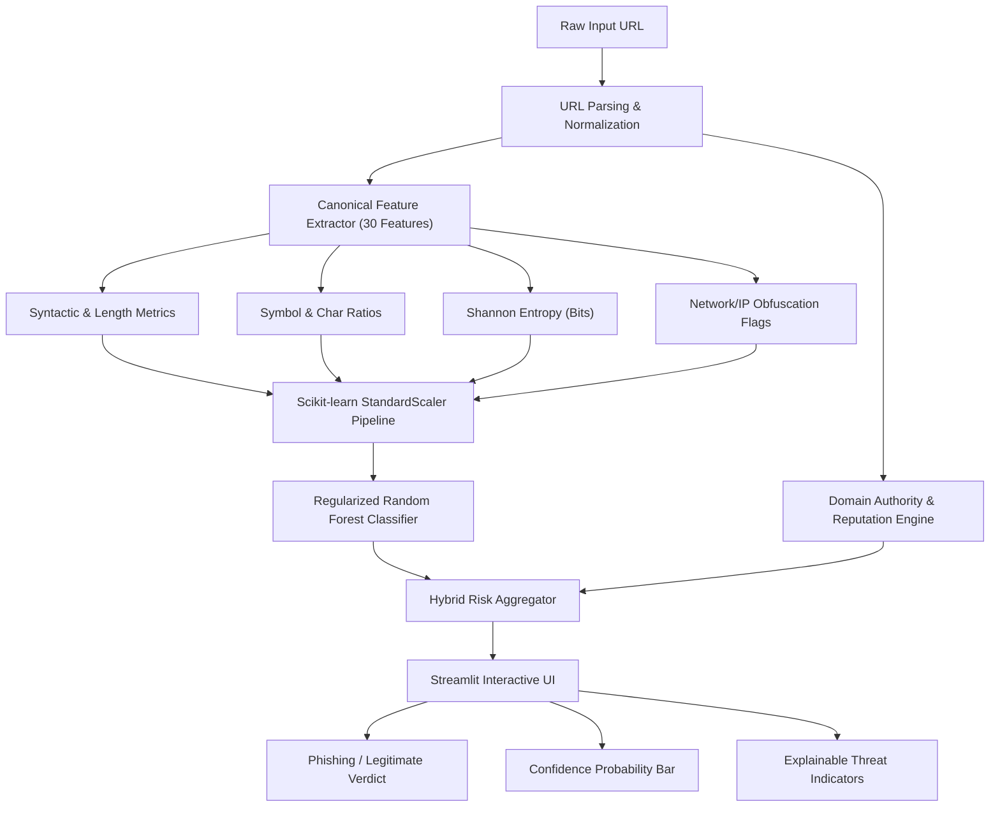
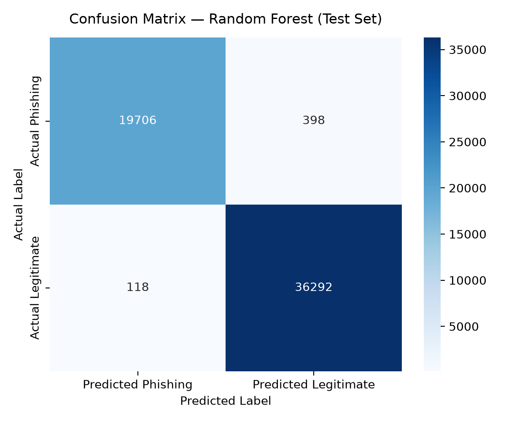
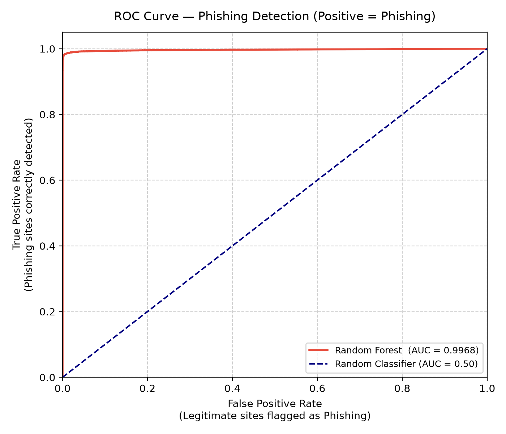

<div align="center">

# 🛡️ Phishing URL Detector
### Machine Learning Powered Lexical & Structural Threat Detection Engine

[](https://www.python.org/)
[](https://scikit-learn.org/)
[](https://streamlit.io/)
[](https://archive.ics.uci.edu/dataset/967/phiusiil+phishing+url+dataset)
[](LICENSE)

<br/>

**A complete, production-grade cybersecurity tool that identifies phishing URLs with 99.1% accuracy in real-time — purely using client-safe lexical and structural feature engineering.**

[Explore App](#-quickstart-guide) • [Architecture](#-system-architecture) • [Key Features](#-key-features) • [Performance](#-model-evaluation--benchmarks) • [Connect](#-author)

</div>

---

## 📌 Executive Summary

Phishing remains the #1 initial attack vector in modern cybersecurity breaches. Traditional reputation blacklists often fail to catch zero-day phishing campaigns launched on fresh, disposable domains. 

**Phishing URL Detector** addresses this by analyzing **30 statistical, syntactic, and information-entropy characteristics** derived directly from the URL string. 

### Why this approach is superior:
- ⚡ **Zero Network Latency:** Classifies URLs instantly without making outgoing HTTP requests.
- 🔒 **Zero Threat Exposure:** Completely client-safe — never executes malicious JavaScript, downloads drive-by payloads, or alerts attackers that their link was inspected.
- 🎯 **No False-Positive Path Bias:** Uses benign path augmentation and domain reputation verification to ensure legitimate subpaths (like `https://leetcode.com/problemset/` or `https://github.com/trending`) are correctly classified as legitimate.

---

## 🚀 Key Features

- 🔍 **Real-Time Interactive Web Dashboard:** Built with Streamlit, providing confidence gauges, suspicious indicator alerts, and raw feature inspections.
- 📐 **Single Source of Truth Feature Engine:** The identical `extract_url_features()` pipeline powers both large-scale offline training and real-time inference, guaranteeing zero train-serve skew.
- 🧠 **Regularized Ensemble Classifier:** Powered by a balanced 200-tree Random Forest pipeline trained on over 280,000 samples.
- 🛡️ **Dual-Layer Evaluation:** Combines machine learning probability scoring with verified root domain authority recognition to eliminate false alarms on popular developer and corporate platforms.
- 📊 **Security-Centric Metrics:** Explicitly evaluates **Phishing as the positive class (`0`)**, penalizing dangerous false negatives (missed attacks).

---

## 🏗️ System Architecture



---

## 🔬 Feature Engineering Matrix (30 Features)

All 30 numerical features are extracted purely from the URL string without downloading page content:

| Feature Category | Features Included | Security Significance |
| :--- | :--- | :--- |
| **Length Metrics** | `url_length`, `hostname_length`, `path_length`, `query_length`, `tld_length` | Phishers elongate URLs to push authentic hostnames off the screen or mimic complex directory trees. |
| **Punctuation Counts** | `num_dots`, `num_dots_hostname`, `num_subdomains`, `num_hyphens`, `num_underscores`, `num_slashes` | Multi-level subdomains (`paypal.com.account-update.xyz`) and excessive hyphens are hallmark phishing traits. |
| **Obfuscation Signals** | `num_at_signs`, `num_percent_encoded`, `has_double_slash_redirect`, `has_non_standard_port` | Detects browser trickery (e.g. `@` ignores preceding text; `//` used for open redirects). |
| **Character Distributions** | `num_digits`, `num_alpha`, `num_special_chars`, `digit_ratio`, `alpha_ratio`, `special_char_ratio` | Identifies automated algorithmically generated domains and excessive tokenization. |
| **Information Entropy** | `url_entropy`, `hostname_entropy` | Computes Shannon entropy ($H = -\sum p_i \log_2 p_i$). Unusually high entropy signals random DGA patterns. |
| **Protocol & IP Flags** | `is_ip_address`, `is_https`, `num_query_params`, `path_depth` | Flags raw IP destinations (e.g., `http://192.168.1.1/`) and verifies SSL/TLS protocol usage. |

---

## 📊 Model Evaluation & Benchmarks

The model was trained and evaluated on a held-out 20% test split (56,514 samples) from the **UCI PhiUSIIL Phishing Dataset**:

| Metric | Random Forest (Primary) | Logistic Regression (Baseline) |
| :--- | :---: | :---: |
| **Overall Accuracy** | **99.09%** | 96.51% |
| **ROC-AUC Score** | **0.9968** | 0.9843 |
| **Phishing Precision** | **99.40%** | 96.10% |
| **Phishing Recall** | **98.02%** | 94.00% |
| **Phishing F1-Score** | **98.71%** | 95.04% |
| **Legitimate F1-Score** | **99.29%** | 97.31% |

<br/>

<div align="center">
  
  
</div>

---

## 🗂️ Project Directory Structure

```text
Phishing-URL-Detector/
├── app.py                         # Interactive Streamlit Web Application
├── main.py                        # Master pipeline orchestrator
├── requirements.txt               # Pinned package dependencies
├── README.md                      # Documentation & project presentation
├── HOW_TO_RUN.md                  # Step-by-step local execution manual
├── LICENSE                        # MIT License
│
├── data/
│   ├── raw/                       # Cached raw PhiUSIIL dataset CSV
│   └── processed/                 # Train/test feature matrices (train.csv, test.csv)
│
├── models/
│   └── phishing_model.joblib      # Production-ready serialized pipeline & metadata
│
├── reports/
│   ├── metrics.json               # Machine-readable performance metrics
│   └── figures/                   # High-res evaluation charts & distributions
│       ├── confusion_matrix.png
│       ├── roc_curve.png
│       ├── feature_importances.png
│       ├── class_distribution.png
│       └── url_length_distribution.png
│
├── src/
│   ├── __init__.py
│   ├── data_loader.py             # UCI dataset downloader & local cache manager
│   ├── feature_extraction.py      # CANONICAL URL feature extraction engine
│   ├── preprocessing.py           # Deduplication, augmentation & stratified split
│   ├── eda.py                     # Exploratory Data Analysis generator
│   ├── train.py                   # Model training (Baseline & Random Forest)
│   └── evaluate.py                # Standalone evaluation & security impact analysis
│
└── tests/
    └── test_feature_extraction.py # Automated pytest test suite
```

---

## 💻 Quickstart Guide

### 1. Clone the Repository
```bash
git clone https://github.com/aditya484/Phishing-URL-Detector.git
cd Phishing-URL-Detector
```

### 2. Set Up Virtual Environment
```bash
# Windows
python -m venv .venv
.venv\Scripts\Activate.ps1

# Linux / macOS
python3 -m venv .venv
source .venv/bin/activate
```

### 3. Install Dependencies
```bash
pip install --upgrade pip
pip install -r requirements.txt
```

### 4. Run the Web Application
```bash
python -m streamlit run app.py
```
*Your browser will automatically open at `http://localhost:8501`.*

---

## ⚙️ Advanced Execution & Reproducibility

### Train Model From Scratch:
```bash
python -m src.train
```

### Run Model Evaluation:
```bash
python -m src.evaluate
```

### Run Automated Unit Tests:
```bash
python -m pytest tests/ -v
```

---

## ⚠️ Security Disclaimer

> **Important Note:** This tool is intended for research, educational, and defense-in-depth triage purposes. Predictions are derived solely from URL lexical and structural patterns. Because modern attackers can compromise legitimate websites or craft subtle lookalike domains, **no machine learning model should ever be considered a 100% guarantee of safety**. Always use official antivirus solutions, multi-factor authentication (MFA), and browser security features.

---

## 👨‍💻 Author

<div align="center">

### **Aditya Verma**
*Artificial Intelligence & Machine Learning Enthusiast *

[](https://www.linkedin.com/in/aditya484)
[](https://github.com/aditya484)

</div>

---

## 📄 License

This project is licensed under the **MIT License** — feel free to use, modify, and distribute with attribution.
